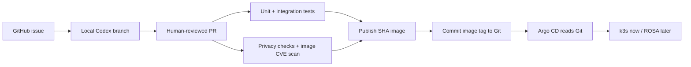
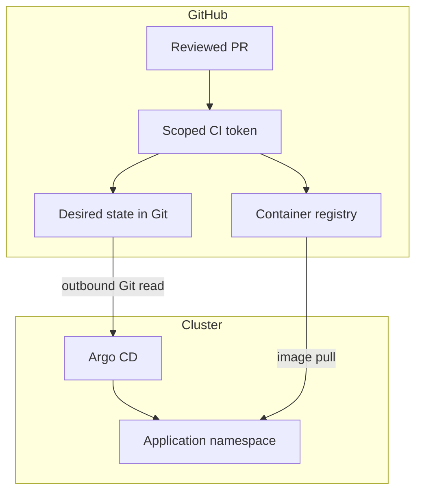

# Workflow and presentation notes

The [HTML](slides/gitops-security-briefing.html), [PDF](slides/gitops-security-briefing.pdf), and [editable PowerPoint](slides/gitops-security-briefing.pptx) share one source: `scripts/build_slides.py`.

## ROSA adoption path

The local cluster is k3s; ROSA is a proposed next environment. Install the supported Red Hat OpenShift GitOps Operator, create a ROSA-specific Kustomize overlay and Route, and validate namespace permissions, SCC admission, image access, identity, and monitoring before a pilot. Keep the issue → review → CI → immutable image → Git desired state loop. [Red Hat OpenShift GitOps installation](https://docs.redhat.com/en/documentation/red_hat_openshift_gitops/1.21/html/installing_gitops/installing-openshift-gitops).

## Rebuild slides

Use Python 3.12+ and a virtual environment. `pip install -r requirements-slides.txt`, then `python scripts/build_slides.py`. The generated files are self-contained for viewing offline. No credential is embedded in the deck.
